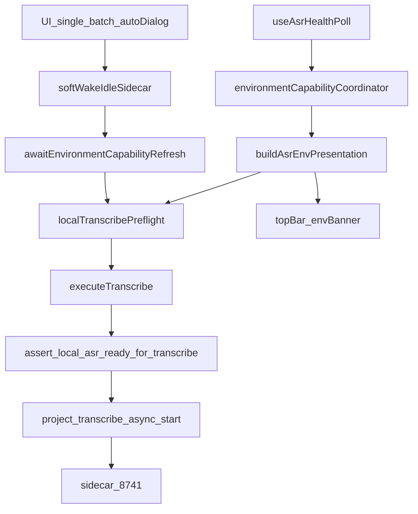

# 审计：本机 FunASR 转写全链路（2026-10）

> **状态**：Phase A 定稿 · Phase B P0/P1 已落码（见 §8）；二次审查发现未修缺陷，**不代表全链路验收通过**  
> **类型**：存量审计（非新功能 research-before-build）  
> **Plan**：Cursor `local_asr_audit_plan`  
> **真源纪律**：[desktop-capability-ui-state-alignment.md](../../architecture/desktop-capability-ui-state-alignment.md)（D1–D8）· [asr-sidecar-funasr-policy.md](../../architecture/asr-sidecar-funasr-policy.md)

---

## 1. 问题陈述

| 项 | 内容 |
|----|------|
| 用户场景 | 本机转写：单文件 / 批量 / 休眠后唤醒 / 一键准备后开转；UI 就绪与真实能否转写须一致 |
| 本仓现状 | 执行收敛到 `executeTranscribe` → Rust `assert_local_asr_ready_for_transcribe`；预检走 coordinator + presentation |
| 近期事故 | stub+磁盘齐假就绪；批量「侧车版本过旧」（overlay `async=false` 盖住 GET `/`）；idle 红条吵 |
| 成功标准 | 入口表 + 矩阵 + 分叉表完整；P0/P1 有落点与验证；无第二套闸门栈 |

**不做什么**：不引入 Sherpa/多引擎实现；不新造 VAD/分段/Provider；不重写 coordinator。

---

## 2. 主链路

| 层 | 落位 |
|----|------|
| 执行 | `useTranscribeJobExecute.ts` · `useBatchTranscribeQueueController.ts` · `useTranscribeJobPreflight.ts` |
| 能力 | `environmentCapabilityCoordinator.ts` · `environmentCapabilityPresentation.ts` · `asrEnvStatus.ts` · `localAsrModelCatalog.ts` |
| Rust | `local_transcribe_gate.rs` · `run_transcribe_cmd/async_cmd.rs` |
| 休眠 | `asr_sidecar/warm.rs` · `localAsrSidecarSoftWake.ts` |

---

## 3. 刀 1 — 用户流入口清单

| 入口 | softWake? | capability refresh? | preflight | Tauri | 失败 UX |
|------|-----------|---------------------|-----------|-------|---------|
| 编辑器单文件 | 是（execute 内） | 是 | coordinator ?? presentation | async→sync fallback | setError toast；invoke 失败 → TranscribeDiagBanner |
| AutoTranscribe 对话框 | 确认后同单文件 | 同左 | 同左 | 同左 | 同左 |
| 欢迎/引导「开始转写」 | 同单文件 | 同左 | 同左 | 同左 | 同左 |
| 批量本机 | **父级一次**；`batchChild` 跳过 | **父级一次** | 父级 preflight；子项因 `busyReason=batch_transcribe` 跳过 local 预检 | 每文件同 local job | 父级 toast；子项队列行；共享环境失败停队 |
| 休眠后转写 | softWake（noop 若非 idle） | 是 | 休眠时 blockReason=`null` | 同调用方 | soft-wake 失败 toast（P0-1） |
| 环境「恢复侧车」 | 是 | 仅 refreshAsrRuntimeInfo | N/A | try_start | toast.warning |
| 一键准备→再转写 | 一键无；下次转写有 | 下次有 | 一键 final 须 `ready`+funasr | 无转写 cmd | wizard blocked/error |
| D1≠D2 | 随调用方 | 随调用方 | 「所选模型与侧车不一致」 | Rust hub≠sidecar | toast / Rust 双 id 文案 |
| stub/corrupt | 随调用方 | 随调用方 | stub blockReason；一键拒 disk-only | mode≠funasr | 「占位引擎」 |
| desktop:dev vs release | 同图 | 同图 | 同码；文案 `packagedOrDev` | 同 cmd | dev 重建提示 / 发行包一键准备 |

---

## 4. 刀 2 — 能力—UI—Rust 矩阵

| 场景 | 顶栏 chip | 环境 banner/行 | blockReason | Rust gate | 一致? |
|------|-----------|----------------|-------------|-----------|-------|
| idle-stop | ASR 已休眠 · warn | 本机 ASR · 空 detail · 行「—」 | `null` | soft-wake 后再闸 | 有意安静；wake 失败见 P0 |
| stub+磁盘齐 | ASR 未就绪 | 运行时未就绪 · 转写不可用 | 占位引擎 | 拒 stub | ✅（本轮已修） |
| async root 真 · overlay false | 优先 last `rootJson`（P1-3） | coordinator 路径就绪 | coordinator `null` | GET `/` 有 async 则过 | ✅（预检+芯片同源） |
| funasr_ready 假 · D4 真 · mode=funasr | 可能就绪（compute 不看 funasr_ready） | 运行时红 · 转写可绿 | 常 `null` | mode=funasr 时 D5 应同真（侧车定义） | 行内自矛盾；与 Rust 通常同 |
| D1≠D2 | 未就绪 | 应用并重启 | 不一致文案 | 拒 | ✅ |
| prepareModelBusy / runtimeInstall | 强制未就绪 | D7 overlay | 忙态文案 | **不见 D7** | UI 闸；Rust 盲（P1） |

---

## 5. 刀 3 — 路径分叉 / 时序

| 分叉 | 说明 | 状态 |
|------|------|------|
| 批量 vs 单次 | 父级 wake+refresh；子项跳过 | 有意；父级已补 refresh |
| overlay vs GET `/` | coordinator 优先 rootJson | ✅ presentation；芯片仍 overlay |
| idle blockReason null | 依赖 soft-wake | wake 失败静默 → P0 |
| one-click diskPrepared | final 已要求 ready | ✅ |
| **foreign-8741 health 流** | `useAsrSetupHealthFlow` 仍 `ready\|\|diskPrepared` 宣称可转写 | **P0** |
| mid-flow diskPrepared 跳过下载 | final 闸 ready 可接受 | P2 文档 |
| syncCatalogFromHealth(root=null) | 把 async capable 写成 false | P1 |
| TS D4 ready vs Rust 要 D5 | 侧车上 mode=funasr⇔D5；仍应对齐防御 | P1 |

---

## 6. 刀 4 — 测试与手测缺口

**已有**：`localAsrModelCatalog` · `asrEnvStatus` · `environmentCapabilityPresentation` · `asrOneClickPrepareReady` · Rust `local_transcribe_gate` · batch queue tests。

**缺口**
- soft-wake 失败在转写路径的断言
- `useAsrSetupHealthFlow` diskPrepared 假完成
- 顶栏 chip 与 coordinator async 同源的回归
- 手测：release DMG · idle→转写 · 批量本机 · stub/损坏侧车 · D1≠D2

---

## 7. Findings（分级）

### P0 — 本 Phase B 必修

1. **转写路径 soft-wake 失败静默**  
   - 复现：idle-stop 后 `try_start` 失败；`softWakeBeforeLocalTranscribe` 不 toast  
   - 落点：`useProjectAsrBridgeStack.ts`  
   - 验证：failed → toast；后续 preflight/Rust 仍可挡

2. **foreign-8741 / 沿用当前服务：diskPrepared 假「可用于转写」**  
   - 复现：`useAsrSetupHealthFlow` `modelSnap.ready \|\| diskPrepared`  
   - 落点：同文件两处 done 判定改为须 `ready`  
   - 验证：stub+cached → blocked，不得 outcome ready

### P1 — 本 Phase B 修

3. **顶栏 async 仍吃 React 默认 false**  
   - 落点：`useAsrBridgeController` presentation 优先 `readLastAsrHealthRefreshResultAfterDiagnostics().rootJson`；`syncCatalogFromHealth` 仅在 root 非空时更新 async flag

4. **TS `computeLocalAsrTranscribeReady` D4 分支对齐 Rust**  
   - 当 `selected_model_ready===false` 且 `funasr_required_models_cached`：另要求 `ready_for_transcribe===true`

5. **D7 UI-only**（prepare/runtime install）  
   - 本轮：**不**把 D7 塞进 Rust；记台账。依赖 health 翻转；若手测仍双开再开薄片

### P2 — 台账不阻塞

- TS/Rust D1≠D2 文案未统一  
- mid-flow `diskPrepared` 跳过下载（final ready 闸已护）  
- 预检失败仅 toast、无 diag banner  
- desktop:dev vs release 仅文案差

### 已修、须回归

- stub 假就绪 / 一键 disk-only 完成  
- idle 安静 UX + chip「已休眠」  
- 批量 GET `/` 优先 + 开批前 refresh  

---

## 8. Phase B 落码（已完成）

| ID | 文件 | 改动 |
|----|------|------|
| P0-1 | `useProjectAsrBridgeStack.ts` | soft-wake failed / woke!healthOk → toast |
| P0-2 | `useAsrSetupHealthFlow.ts` | 「可用于转写」须 `ready`，拒裸 diskPrepared |
| P1-3 | `useAsrBridgeController.ts` · `useLocalAsrModelCatalog.ts` | chip/presentation 优先 GET `/`；null root 不 clobber async |
| P1-4 | `localAsrModelCatalog.ts` + test | D4 分支要求 `ready_for_transcribe` |

P1-5 D7 UI-only → 仍台账，未改 Rust。

验证：相关 vitest · `tsc --noEmit` · 手测 §7。

## 9. 二次审查（2026-10-31）

见 [二次审查问题报告](local-transcribe-flow-review-report-2026-10-31.md)：4 项已复现缺陷、1 项桌面异常、机器验证与实机边界。按用户要求停止进一步核验；问题尚未修复。§5/§7 保留为历史发现与计划，当前结论以二次审查报告为准。
