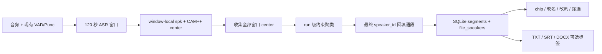

# Plan：R3g-D 本机说话人分离

> **状态**：已批准并实施；D0 判定 Partial Go（默认关闭、实验能力）  
> **Research**：[`r3g-d-speaker-diarization-research.md`](./r3g-d-speaker-diarization-research.md)  
> **Intent**：[`r3g-d-speaker-diarization-intent.md`](./r3g-d-speaker-diarization-intent.md)  
> **Acceptance**：[`r3g-d-speaker-diarization-acceptance.md`](./r3g-d-speaker-diarization-acceptance.md) · **Spike**：[`r3g-d-speaker-diarization-spike-results.md`](./r3g-d-speaker-diarization-spike-results.md)  
> **架构真源**：[`asr-sidecar-funasr-policy.md`](../../architecture/asr-sidecar-funasr-policy.md) · [`desktop-capability-ui-state-alignment.md`](../../architecture/desktop-capability-ui-state-alignment.md)

## 0. 最终落地结论

本 Epic 是 **Paraformer 管线的可选 CAM++ 能力**，不是换 ASR 引擎。执行顺序固定为：

```text
D0 Spike 门禁
  → D1 数据契约与持久化
  → D2 单窗 speaker 输出
  → D3 分窗全局归一与 async finalization
  → D4 命名、纠错与编辑规则
  → D5 导出、平台发行与路线图回填
```

D0 未达到 Go / Partial Go 的书面门禁前，不进入 D1–D5。v1 默认关闭、CAM++ 按需下载；任何阶段关闭该能力都应回到当前 Paraformer 行为。

## 1. 目标数据流



异步预览只从 B 提交正文和时间轴，`speaker_id=null`；E 完成后才提交最终 speaker 结果。这样正文可以逐窗出现，但用户不会看到不断跳号的 provisional speaker。

## 2. 契约与真源

### 2.1 Sidecar 请求 / 响应

- 转写请求增加 additive `diarization_requested: bool = false`，记录本次 job 意图。
- sidecar 若收到 `true` 但 CAM++ 未缓存/未加载，返回结构化“组件未准备”错误，不回落成无 speaker 的成功。
- 最终响应增加：
  - `segments[].speaker_id: str | null`
  - `diarization.run_id: str | null`
  - `diarization.status: "disabled" | "final"`
  - `diarization.speaker_count: int | null`
  - `diarization.warnings: string[]`
- 异步窗口 preview 保持现有事件形态，但 segment speaker 恒 `null`；不得对外暴露 local `spk`。
- `speaker_id` 格式视为 opaque；实现可用 `spk:<run_uuid>:<ordinal>`，消费者不得解析 ordinal。

### 2.2 SQLite

```sql
ALTER TABLE segments ADD COLUMN speaker_id TEXT;
ALTER TABLE files ADD COLUMN diarization_run_id TEXT;

CREATE TABLE file_speakers (
  file_id TEXT NOT NULL,
  speaker_id TEXT NOT NULL,
  ordinal INTEGER NOT NULL,
  display_name TEXT,
  created_at_ms INTEGER NOT NULL,
  updated_at_ms INTEGER NOT NULL,
  PRIMARY KEY (file_id, speaker_id),
  FOREIGN KEY (file_id) REFERENCES files(id) ON DELETE CASCADE
);
CREATE UNIQUE INDEX idx_file_speakers_ordinal
  ON file_speakers(file_id, ordinal);
```

- `segments.speaker_id` 是实际段归属真值；旧数据与未 final 数据为 `NULL`。
- `files.diarization_run_id` 标识当前 segments 所属 run；speaker 全 null 时可为 `NULL`。
- `file_speakers` 是默认顺序与用户显示名唯一真源。默认文案不落成姓名：`display_name IS NULL` 时按 `ordinal` 显示“说话人 N”。
- 文件复制、移动、删除、项目包导出/导入必须在同一事务或同一 bundle 版本中携带 roster。App Data 不另存副本。

### 2.3 重转写事务

1. 前端发现当前文件 roster 有非空 `display_name` 时，开始全文重转写前提示“现有说话人命名将需要重新确认”。
2. 用户确认后运行新 job；旧 segments / roster 在 job 成功前保持不动。
3. 新 job final 后以单一事务替换 segments、`diarization_run_id` 和 roster。
4. job 失败或取消，旧数据完整保留。
5. v1 不将旧姓名自动映射到新 run；这是声纹身份识别，不属于本 Epic。

## 3. 跨窗归一算法

### 3.1 主路径

每个窗口保留内部结果：

```text
(window_id, local_spk, center_vector, speech_duration, first_seen_sec)
```

全部窗口完成后：

1. 对 center 做 L2 normalize，计算 cosine similarity matrix。
2. 以 spike 标定阈值做凝聚式聚类；同一窗口内两个不同 local speaker 设为 cannot-link，禁止合并。
3. 2 秒重叠区域中同一时间主体 speaker 的一致性只作 tie-breaker，不作为无 embedding 时的替代算法。
4. cluster center 按该 local speaker 的有效语音时长加权。
5. 结果 cluster 按全文首次出现时间排序，创建新的 run-scoped opaque ID 和 ordinal。
6. local `(window, spk)` → final `speaker_id` 映射回填语段；再执行现有 overlap trim / sort。
7. 超过 `max_speakers`、相似度落在不确定带、center 缺失时写 warning；不得静默把所有未知项并到 `spk0`。

聚类输入规模约为“窗口数 × 每窗人数”，与音频采样点无关，适合长音频。阈值、`max_speakers` 默认值和不确定带必须由 D0 数据确定，不在文档中拍脑袋写死。

### 3.2 回退顺序

1. FunASR 当前 pin 的 `return_spk_center=True` 可用：采用主路径。
2. center 返回不稳定：用同一 CAM++ 对句段音频提 embedding，再进入相同全局聚类。
3. 仅单次短音频可靠：短音频 Partial Go，120 秒以上长音频 UI 禁用并说明限制。
4. 不允许的回退：文本邻接、窗口 label 同名、时间相邻即同人。

## 4. 执行切片

### D0：研究 Spike 与门禁（2–3 人日）

1. 固定当前发行 FunASR pin、Paraformer/VAD/Punc，只增加官方 CAM++。
2. 至少准备五类可复现金标：单人、双人干净、双人跨 120 秒边界、三人轮换、噪声/远场；多人样例提供 RTTM 或等价 speaker-time truth。
3. 比较三条路径：无 CAM++ ASR 基线、整段单次 CAM++ 参考、120 秒分窗 + 全局聚类。
4. 记录 DER、speaker confusion、miss/false alarm、单人误拆、跨窗相对整段增量、speaker coverage、CER、segment count、whole-track fallback、wall/RTFx、峰值 RSS、模型落盘大小。
5. 验证 `return_spk_center` 的类型、顺序与 local `spk` 对应关系；验证 per-request 关闭能否避免额外计算。不能则将 v1 定为 profile apply/restart，不保留虚假 job 开关。
6. 跑 macOS arm64 源码侧车与 Windows CPU 源码/冻结产物至少各一次准备、warmup、短音频 smoke。
7. 产出 `r3g-d-speaker-diarization-spike-results.md`，明确 Go / Partial Go / Defer / No-go 和实测阈值。

### D1：数据契约与持久化（2–3 人日）

1. Python `TranscriptionSegment`、sidecar response、Rust `SegmentDto`、TS 两套 contract 增加 optional `speaker_id`。
2. 增加 `files.diarization_run_id`、`file_speakers` migration 与 CRUD command；默认名称由 ordinal 派生。
3. 审计全部字段传播点，不只改类型：

| 传播面 | 必查位置 | 验证 |
|--------|----------|------|
| Python 重建 segment | `segmentation.py`、`transcribe_windows.py` | offset / trim / merge 不丢 `speaker_id` |
| Rust JSON → DTO | `transcribe_response.rs`、online normalize | additive JSON round-trip |
| DB | file load/save、转写 replace、import/create | 旧库迁移、保存重开 |
| 文件操作 | copy/move/delete | roster 跟随或 cascade |
| 项目包 | export/import document | 新字段往返，旧版本可读 |
| TS 编辑 | equality/signature、normalize、undo/snapshot | speaker 改动触发 dirty/save |

4. 修正 `segmentation._row_text`：`spk` 永远不能作为正文兜底。

### D2：单窗侧车与组件能力（2–3 人日）

1. prepare/catalog 注册 `iic/speech_campplus_sv_zh-cn_16k-common`，以 manifest + 必需文件 + 大小/hash 验证完整；下载采用 staging → verify → atomic promote。
2. `funasr_engine_load` 可选挂 CAM++；关闭时不解析、不下载、不加载。
3. 单窗生成 `sentence_info.spk`，转换为 run-scoped ID；未返回 speaker 的句保持 null 并记录 warning。
4. `/health` / runtime caps 增加 additive component fields，但不改变全局 ASR ready：
   - `funasr_spk_model_cached`
   - `funasr_spk_model_id`
   - `funasr_spk_model_loaded`
5. 设置保存默认偏好；若当前 sidecar 配置不一致，沿用现有“应用并重启”模式。D0 若证明可安全请求级开关，再减少重启，不提前承诺。

### D3：长音频与异步 finalization（3–4 人日）

1. 为窗口内部结果增加 local center side channel，不把向量写入公共 segment DTO 或 SQLite。
2. 实现 §3 的 constrained clustering 和明确 warning；单测覆盖跨窗同人、同窗不可合并、缺 center、阈值边界。
3. async preview speaker 恒 null；final response 一次带最终 ID。取消/失败不得留下半成品 roster。
4. 现有 `offset_segments`、`trim_window_prefix_overlap`、Rust preview/final replace 路径做字段保留测试。
5. 以整段参考和 RTTM 金标回归 130 秒、30 分钟及 2 小时样例。

### D4：文稿命名、纠错与编辑规则（2–3 人日）

1. meta gutter / 行首显示 compact chip；无 `speaker_id` 不显示空壳。
2. 两种不同操作：
   - **重命名说话人**：更新 `file_speakers.display_name`，影响该 speaker 所有段；
   - **更改此段说话人**：单段或多选 segments 改派到已有 speaker，或创建新的 speaker roster 项。
3. 轻量筛选“全部 / 某 speaker / 未标注”；只影响列表可见性，不改段数据。
4. 编辑规则锁定：

| 操作 | 规则 |
|------|------|
| 拆段 | 两个子段继承原 `speaker_id` |
| 合段：ID 相同（含两者 null） | 保留原值 |
| 合段：一个 null、一个非 null | 保留非 null |
| 合段：两个不同非 null | 弹出 A / B / 不标注；默认不静默继续 |
| 删除最后一个 speaker 的所有段 | roster 可保留到用户显式清理；导出不输出空 speaker |
| 撤销 / 重做 | segment 改派与 roster 改名均可恢复，且 dirty 状态正确 |

5. 全文重转写按 §2.3 提示并事务替换。UI 不做声纹 confidence 和重叠语音多标签。

### D5：导出、发行与回写（1–2 人日）

1. TXT / SRT / DOCX 共用 speaker label formatter，不在三处各造名称逻辑。
2. 导出选项“包含说话人标签”：有非空 speaker 时默认开，用户可关；全 null 时隐藏/禁用且输出与当前一致。
3. SRT 采用 `显示名：正文`；TXT / DOCX 在 speaker 切换或每段前输出标签，具体排版由 snapshot 测试锁定。
4. v1 CAM++ 只按需下载，不加入 Tauri 安装资源；更新 third-party notice、policy、用户指南和诊断信息。
5. Windows/macOS 冻结 sidecar smoke；完整性错误必须区分“未下载 / 下载不完整 / 已缓存未加载 / 配置不一致”。
6. 回填 Acceptance 实测、路线图状态、旧 ASR landscape 的 Nano 依赖描述。

## 5. 能力—UI 状态矩阵

| 用户偏好 | CAM++ 缓存 | 侧车加载 | Job 请求 | 结果状态 | UI / 行为 |
|----------|-------------|----------|----------|----------|-----------|
| 关 | 任意 | 否 | 否 | disabled | 正常转写；无 chip；全局 ready 不受影响 |
| 开 | 否 | 否 | 是 | 未开始 | 显示“需准备说话人模型”，进入组件下载 |
| 开 | 是 | 否 | 是 | 未开始 | 显示“配置待应用”，应用并重启后再发 job |
| 开 | 是 | 是 | 否 | disabled | 允许普通转写；不得伪造 speaker 结果 |
| 开 | 是 | 是 | 是 | preview | 正文可预览，speaker chip 暂不出现 |
| 开 | 是 | 是 | 是 | final | segments + roster 原子落库，显示 chip |
| 开 | 是 | 是 | 是 | failed/cancelled | 保留旧文件数据；显示结构化失败原因 |

数据源分别是：设置偏好、catalog manifest、`/health` 实际加载、job request snapshot、sidecar final response。禁止用 `/health.ready_for_transcribe` 代替其中任一项。

## 6. TDD 与验证顺序

```text
D0 spike report
  → RED/GREEN: Python schema + segmentation + center mapping
  → RED/GREEN: SQLite migration + DTO + roster CRUD + bundle round-trip
  → RED/GREEN: prepare integrity + load with/without CAM++
  → RED/GREEN: constrained clustering + async preview/final
  → RED/GREEN: TS dirty/save + rename/reassign + split/merge
  → RED/GREEN: shared export formatter + TXT/SRT/DOCX snapshots
  → asr tests + typecheck + test + lint + architecture guard
  → macOS/Windows smoke + manual main path
```

每个切片完成后运行与风险相称的定向测试；D5 收口必须执行：

```bash
npm run typecheck && npm run test && npm run lint && node scripts/check-architecture-guard.mjs
```

并按仓库脚本补跑 ASR 测试、Rust 测试和冻结产物 smoke。

## 7. 风险与止损

| 风险 | 早期信号 | 止损 |
|------|----------|------|
| center API 与当前 pin 不兼容 | 返回缺失、顺序无法对应 local spk | 句级 CAM++ embedding 回退；仍失败则长音频 Partial/Defer |
| 跨窗误合并 / 误拆 | windowed DER 比整段显著恶化 | 收紧阈值、暴露人数提示仅供 spike；不过门禁不发布长音频 |
| 单人被误拆多人 | single-speaker false split | 默认保持关；加入单人硬门禁而非只测多人 |
| ASR 时间轴 / CER 回归 | segmentation mode 或 CER 超阈 | diarization 不默认开；不得放宽原 ASR 门禁 |
| 字段传播漏改 | preview 有值、保存后丢失 | 传播矩阵逐项测试；架构 guard 增加 literal/field 检查可行性评估 |
| 重转写姓名错配 | 新 run 复用旧 label | 新 run ID + 明示重置；不做自动声纹映射 |
| Windows 模型不完整 | 目录存在但缺文件 | staging + manifest 校验 + atomic promote；v1 不捆绑安装包 |
| UI 复杂化 | chip 与听跳/编辑冲突 | 使用既有 compactDialog / meta gutter；色轨与声纹管理后置 |

## 8. 工期与完成定义

| 切片 | 估时 |
|------|------|
| D0 Spike | 2–3 人日 |
| D1 契约 / DB | 2–3 人日 |
| D2 单窗侧车 / 组件 | 2–3 人日 |
| D3 跨窗 / async final | 3–4 人日 |
| D4 UI 纠错 | 2–3 人日 |
| D5 导出 / 发行 | 1–2 人日 |
| **合计** | **12–18 人日，单人约 2–3 周** |

完成必须同时满足：

- D0 有可复现报告并作出书面 Go/Partial/Defer/No-go。
- 短音频与支持范围内长音频满足 DER、跨窗和 ASR 回归门禁。
- speaker 能保存、改名、改派、拆合、撤销、重开和项目包往返。
- 关闭时现有 ASR 与导出完全兼容；CAM++ 缺失不影响全局转写 ready。
- macOS/Windows smoke 和仓库机器守卫全绿；Acceptance 填入实测证据。
